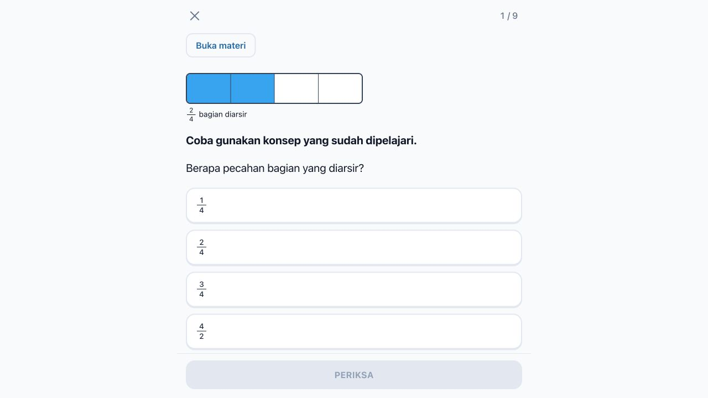
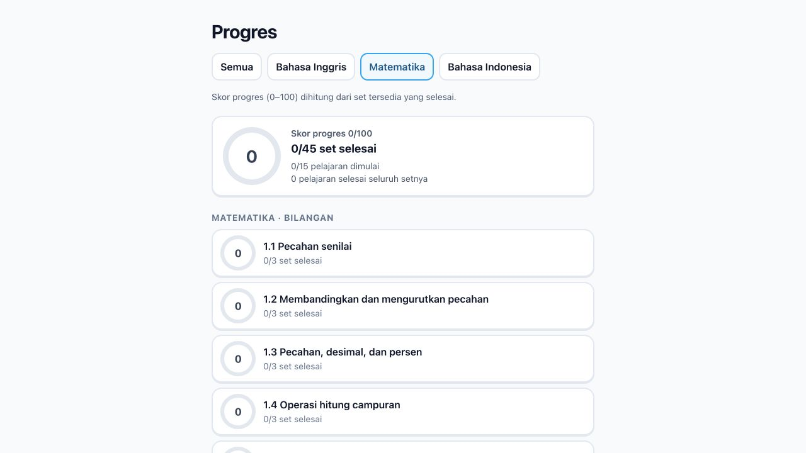

# Skor progres dan notasi pecahan

- Progres tampil dalam skala 0–100, dengan label `Skor progres …/100`. Perhitungan tetap berdasarkan set selesai dibagi set tersedia, dibulatkan ke atas.
- Hasil percobaan pertama TKA menampilkan `Skor …/100` dan jumlah jawaban benar. Latihan ulang tetap tidak menambah skor awal.
- Pecahan numerik ditampilkan dengan pembilang di atas penyebut dan garis pemisah di materi, soal, pilihan jawaban, pembahasan, hasil, dan riwayat Matematika.
- Pembaca layar mendapat label seperti “1 per 2”. Pecahan campuran tetap mempertahankan bagian bilangan bulatnya. Format tanggal, pecahan dengan penyebut nol, dan teks mata pelajaran lain tidak diubah.
- Pemformatan hanya saat tampilan: nilai pilihan, kunci, konten Supabase, dan data hasil tetap memakai format asli. Tidak diperlukan migrasi atau seed ulang.

## Verifikasi

14 tes berhasil, termasuk render pecahan dan pemeriksaan jawaban asli; typecheck, lint, dan production build berhasil. Browser memverifikasi materi operasi pecahan, pilihan pecahan senilai, serta skor progres Matematika. Pemeriksaan browser tidak mengirim jawaban latihan atau menulis data baru ke database.

Commit dibuat lokal; tidak ada push atau PR.
